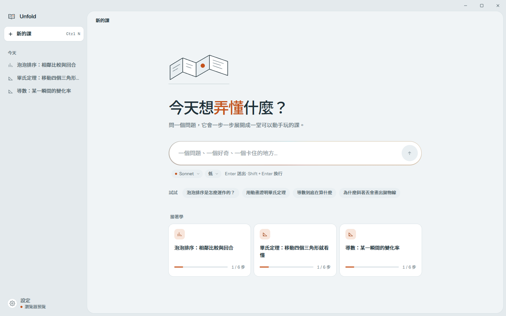

# Unfold

A personal interactive tutor powered by your local [Claude Code](https://docs.anthropic.com/en/docs/claude-code). Ask a question and get a step-by-step lesson played alongside an interactive visual.



## Features

- **Step-by-step interactive visuals** — Every lesson pairs short narration steps with a synced visual:
  - **Plot** — Mafs coordinate plane with animated parameters, draggable points, tangents, areas, Riemann sums, and live readouts.
  - **Visual kit** — Built-in interactive charts, diagrams & flowcharts, system architectures, timelines, comparisons, key-point cards, annotated passages, step-by-step code traces, and formative quizzes.
  - **Custom HTML/SVG** — Sandboxed, animated interactive widgets generated for physics, chemistry, biology, geometry, and mechanisms.
- **Ask first & whole courses** — Unfold can ask clarifying questions before teaching, or plan and generate a multi-chapter course one chapter at a time.
- **Reference folders** — Attach local project or document folders (or drag and drop them onto the window) so lessons are grounded in your actual files with read-only sandboxing and cited sources.
- **Continuous follow-ups** — Ask follow-up questions in the same lesson; sessions resume in place and choose between opening a new chapter, extending the current visual, or replying in text.
- **Offline typography** — Bundled Instrument Sans, DM Mono, and sliced GenYo Gothic TW fonts.

## Requirements

- [Claude Code](https://docs.anthropic.com/en/docs/claude-code) installed and signed in (`claude --version`)
- [Bun](https://bun.sh/)
- [Rust](https://www.rust-lang.org/) (for building the Tauri desktop shell)

## Quick Start

```sh
cd app
bun install
bun run tauri dev
```

To preview the UI in a browser with sample lessons (no Claude required):

```sh
cd app
bun run dev
```

To run the test checks:

```sh
cd app
bun run check
```

To build the desktop installer (Windows NSIS, per-user):

```sh
cd app
bun run tauri build
```

## Project Layout

- [`app/`](app/) — Desktop application (Tauri + React + Vite) and Claude Agent SDK sidecar. See [`app/README.md`](app/README.md) for architecture details and keyboard shortcuts.
- [`showcase/`](showcase/) — Screenshots, visual kit samples, and the scripted product video renderer ([`showcase/video/README.md`](showcase/video/README.md)).

## Third-Party Assets

- **Icons**: Subset of [Lucide](https://lucide.dev) (ISC License; portions from Feather, MIT License).
- **Fonts**: [Instrument Sans](https://fonts.google.com/specimen/Instrument+Sans), [DM Mono](https://fonts.google.com/specimen/DM+Mono), and [GenYo Gothic TW](https://github.com/buttaiwan/genyog-font) (SIL Open Font License 1.1).

## License

[MIT](LICENSE)
